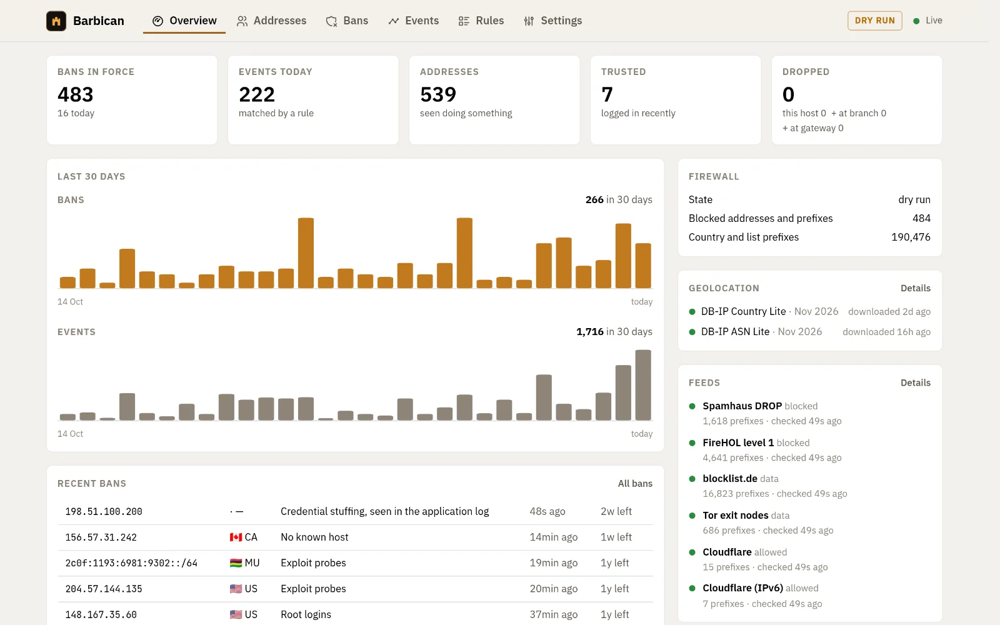

# Barbican

[](https://github.com/nikarh/barbican/actions/workflows/ci.yml)
[](https://barbican.arhipov.net/)
[](LICENSE-MIT)
[](LICENSE-APACHE)

Barbican reads your servers' logs, decides with rules which addresses are abusing your services, and blocks them in
the kernel, on the server and, through small edge agents, on your router. Countries and public blocklists can be
blocked as a whole. A web UI shows what every address tried and why it was banned, and is where rules, ban lengths,
countries and lists are edited. It is one program with one configuration file and a SQLite database.

<picture>
  <source media="(prefers-color-scheme: dark)" srcset="site/src/assets/screenshots/overview-dark.webp">
  
</picture>

```text
 server logs ─► agent: parse ─► rules ─► bans, trust ─► SQLite
 (local, or shipped        │
  from other servers)      ├─► kernel firewall on this server
                           └─► TLS ─► edge agents ─► kernel firewall on routers
```

Each part is an interface with a few implementations today:

| Part | Today |
| --- | --- |
| Log inputs | Docker API, files (followed across rotation), the systemd journal, VictoriaLogs queries |
| Parsers | Traefik, OpenSSH, Authelia, regular expressions |
| Lists | Countries and continents (DB-IP), Spamhaus DROP, FireHOL level 1, blocklist.de, Tor exits, Cloudflare's ranges (to allow), any URL |
| Firewalls | nftables on the server and on OpenWrt; iptables with ipset on firmware without nftables (Asuswrt-Merlin) |
| Packages | Debian, Arch, static binaries (x86_64, aarch64); OpenWrt with LuCI pages (armv7, aarch64, x86_64); the UI as a container image |

Edge agents connect out to the agent over TLS with a pinned certificate and a token each. The UI has no network port:
the agent serves it on a unix socket, and browsers reach it through a container behind your authenticating reverse
proxy. [Compared with other tools](https://barbican.arhipov.net/start/comparison/) explains how it relates with fail2ban, CrowdSec
and others.

## Install

Packages for Debian, Ubuntu and Arch Linux, static binaries for any Linux (x86_64 and aarch64), and edge agents for
OpenWrt and Asuswrt-Merlin are in each [release](https://github.com/nikarh/barbican/releases), with signed checksums
(key [`docs/signing-key.asc`](docs/signing-key.asc), `2DED94B14E12F49939656D6611E3B0A85A53607A`). See
[Installation](https://barbican.arhipov.net/install/overview/), then the
[Quick start](https://barbican.arhipov.net/start/quick-start/).

Try it first without touching the firewall: `barbican --dry-run` (or `[firewall] enabled = false` in
`/etc/barbican/config.toml`) decides and records everything, and changes nothing.

## Documentation

The [documentation site](https://barbican.arhipov.net/) has a version for each release. Good places to start:

- [Introduction](https://barbican.arhipov.net/start/introduction/), [Compared with other tools](https://barbican.arhipov.net/start/comparison/) and [Quick start](https://barbican.arhipov.net/start/quick-start/)
- [Planning a deployment](https://barbican.arhipov.net/guides/deployment/): where each part runs so that blocks work
- [Sources and parsers](https://barbican.arhipov.net/guides/sources/), [Rules and policy](https://barbican.arhipov.net/guides/rules/), and [Countries, blocklists and allow lists](https://barbican.arhipov.net/guides/feeds/)
- [The web UI](https://barbican.arhipov.net/guides/ui/), [Behind a reverse proxy](https://barbican.arhipov.net/guides/reverse-proxy/), and [Importing old logs](https://barbican.arhipov.net/guides/import/)
- [Edge agents](https://barbican.arhipov.net/edge/overview/)
- [Configuration](https://barbican.arhipov.net/reference/configuration/), [command line](https://barbican.arhipov.net/reference/cli/) and [resource use](https://barbican.arhipov.net/reference/resources/)
- How it works: [the engine](https://barbican.arhipov.net/internals/how-it-works/), [the firewall](https://barbican.arhipov.net/internals/firewall/), [agents and edges](https://barbican.arhipov.net/internals/edge-link/), [the UI's protection](https://barbican.arhipov.net/internals/control-surface/) and [Security](https://barbican.arhipov.net/internals/security/)

## Contributing

See [Development](https://barbican.arhipov.net/project/development/) for building, testing and the end-to-end suites.

## Attribution and license

IP geolocation by [DB-IP](https://db-ip.com), under the
[Creative Commons Attribution 4.0 International License](https://creativecommons.org/licenses/by/4.0/), when
Barbican downloads its databases.

Licensed under either of [Apache License, Version 2.0](LICENSE-APACHE) or [MIT license](LICENSE-MIT) at your option.
